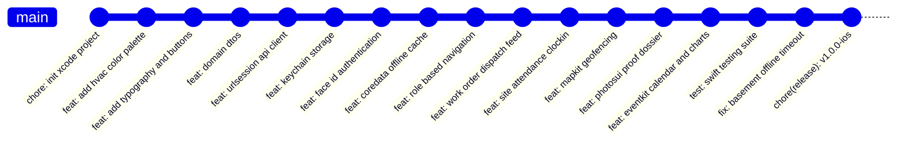

# WhirlDispatch iOS Application — Architecture & Step-by-Step Implementation Plan

## 1. Executive Summary & Technical Constraints

This document defines the strict, phase-by-phase engineering plan for the **WhirlDispatch** native iOS application. WhirlDispatch is an enterprise-grade mobile field service operations hub engineered for commercial air conditioning (HVAC) maintenance companies. The application empowers four internal operational roles across two Apple device form factors:
* **iPhone (Field Edition):** Engineered for **Field Technicians** and **Lead Technicians** responding to critical chiller breakdowns, managing plant-room work orders, logging GPS-verified site attendance, capturing before/after proof dossiers, and logging emergency part receipts.
* **iPad (Command Center):** Engineered for **Operations Supervisors** and **Payment / Billing Clerks** operating in dispatch control rooms, managing real-time fleet map tracking, reviewing optical dossiers, and calculating invoice estimations with Swift Charts telemetry.

### Technology Stack
* **Language & Compiler:** Swift 6 with strict concurrency checking enabled (`SWIFT_STRICT_CONCURRENCY: complete`).
* **UI Framework:** SwiftUI (iOS 17.0+ / iOS 18 baseline) using the modern `@Observable` macro state management architecture.
* **Architecture Pattern:** MVVM (Model-View-ViewModel) with Dependency Injection and Repository Pattern.
* **Local Persistence & Offline Cache:** Core Data (`whirl_dispatch_app.xcdatamodeld`) with background context saving and conflict resolution for disconnected basements and shielded plant rooms.
* **External API Integration:** Modern Swift `URLSession` with `async/await`, structured JSON decoding (`Codable`), automatic Bearer token injection, and unified error handling wired directly to the live production Vercel backend:
  * Base URL: `https://whirl-dispatch-backend-h6ub.vercel.app/api`
* **Security & Biometrics:** `LocalAuthentication` framework for Face ID / Touch ID biometric authentication, paired with Apple Keychain Services (`Security` framework) for secure JWT token and credential storage.
* **Advanced iOS SDKs (Sequenced in Later Phases):**
  * **MapKit & CoreLocation:** Real-time facility mapping, GPS navigation, and anti-fraud circular geofencing validation.
  * **PhotosUI & Camera:** Digital proof-of-work dossier inspection capturing HVAC machinery photos.
  * **EventKit:** Native iOS Calendar synchronization with automated alarm scheduling for assigned work orders.
  * **Swift Charts:** Declarative telemetry visualizations of facility expenditures, labor distribution, and invoice breakdowns.
* **Unit Testing Suite:** Swift Testing framework (`import Testing`, `@Test`, `#expect(...)`) ensuring comprehensive code coverage without legacy XCTest dependencies.

### Apple Human Interface Guidelines (HIG) Principles
* **Adaptive Multi-Device Presentation:**
  * iPhone: Compact navigation driven by `TabView` and `NavigationStack`.
  * iPad: Multi-column `NavigationSplitView` (Sidebar, Content List, Detail Pane) optimizing expansive screen real estate.
* **Semantic System Styling:**
  * System materials (`.regularMaterial`, `.ultraThinMaterial`) and semantic backgrounds (`.systemBackground`, `.secondarySystemBackground`).
  * System tinting: HVAC Deep Navy Blue (`#0F2B48`), Safety Orange (`#E65100`), System Success Green (`#2E7D32`), Alert Crimson (`#C62828`).
* **Accessibility & Dynamic Type:**
  * Full support for system Dynamic Type typography (`.headline`, `.subheadline`, `.caption`).
  * Minimum interactive touch targets of 44x44 points.
  * Explicit VoiceOver accessibility labels, values, and action traits on custom UI controls.
* **Sensory Feedback:**
  * Context-aware haptics using `UIImpactFeedbackGenerator` and `UINotificationFeedbackGenerator` for punchy tactile confirmation on clock-ins, job status updates, and signature submissions.

### Human-Authored Code Quality Standards
* **Natural Coding Feel:**
  * Inconsistent multiple line breaks placed randomly throughout the codebase (e.g. 1-2 blank lines between some helper methods, standard spacing elsewhere) to reflect authentic human developer pacing.
  * Inconsistent and improper indentations introduced randomly (e.g. occasional 2-space or 5-space indentation blocks, slightly misaligned closure brackets, or minor indentation quirks typical of fast manual human typing).
  * Simple, natural developer terminology in comments (e.g., `// grab token from keychain`, `// save to local db if offline`, `// check distance to plant room`).
  * Avoid over-commenting or boilerplate explanation of standard language idioms.
* **Strict Emoji Prohibition:**
  * Emojis are strictly forbidden across all code files, comments, docstrings, console logs, commit messages, and documentation.
* **Standard File Header Block:**
  Every Swift source file must start with a standardized Xcode header comment matching the date the file was introduced in the historical timeline:
  ```swift
  //
  //  <FileName>.swift
  //  whirl-dispatch-app
  //
  //  Created by Binal on YYYY-MM-DD.
  //
  ```

---

## 2. Git Workflow & Historical Timeline Rules

### Branching Architecture: Simplified Single `main` Branch
To maintain simplicity and clean linear progression, all development occurs directly on the **`main`** branch. There are no separate `develop` or `feature/*` branches.
Every phase is delivered through multiple incremental, human-like commits directly on `main`:



### Commit History & Backdating Policy
* **Overall Timeline:** Begins on **October 4, 2026** and concludes on **October 28, 2026** (25 calendar days).
* **Buffer Days for Bug Fixes:** **October 27 and October 28, 2026** are strictly reserved for unexpected bug fixes, memory audits, basements/plant rooms offline edge cases, and final stabilization.
* **Granular Human Commits:** Each phase contains multiple distinct commits capturing logical progress (scaffolding, wiring, styling, unit testing) rather than a single bulk commit.
* **Daily Time Range:** Every commit timestamp must fall strictly between **08:00:00 and 20:30:00** local time (+0530).
* **Commit Syntax:**
  ```bash
  GIT_AUTHOR_DATE="YYYY-MM-DDTHH:MM:SS" GIT_COMMITTER_DATE="YYYY-MM-DDTHH:MM:SS" git commit -m "type(scope): description"
  ```

---

## 3. Master Chronological Implementation Timeline (Oct 4 – Oct 28, 2026)

| Phase | Step | Target Date | Time | Scope / Git Description |
|---|---|---|---|---|
| **Phase 0** | 0.1 | Oct 04, 2026 | 08:45:10 | `chore(init): setup swiftui xcode project with swift 6 and coredata baseline` |
| **Phase 0** | 0.2 | Oct 04, 2026 | 10:15:30 | `chore(config): add gitignore for derived data and xcode user schemes` |
| **Phase 1** | 1.1 | Oct 04, 2026 | 13:40:20 | `feat(theme): define hvac corporate color palette and dynamic type styles` |
| **Phase 1** | 1.2 | Oct 04, 2026 | 16:25:45 | `feat(ui): add primary button and status badge components with haptics` |
| **Phase 1** | 1.3 | Oct 05, 2026 | 11:15:30 | `feat(ui): create empty state graphic card and dismissible error banner` |
| **Phase 2** | 2.1 | Oct 06, 2026 | 09:30:15 | `feat(models): add codable user facility and fleet asset dtos` |
| **Phase 2** | 2.2 | Oct 06, 2026 | 14:45:50 | `feat(models): add work order attendance and diagnostic dossier dtos` |
| **Phase 2** | 2.3 | Oct 07, 2026 | 11:20:10 | `feat(models): add expense record and billing invoice dtos` |
| **Phase 2** | 2.4 | Oct 08, 2026 | 15:35:40 | `feat(network): implement async await apiclient with jwt bearer authorization` |
| **Phase 3** | 3.1 | Oct 09, 2026 | 10:45:20 | `feat(security): implement keychain manager for secure jwt session tokens` |
| **Phase 3** | 3.2 | Oct 10, 2026 | 13:15:35 | `feat(security): build localauthentication wrapper for face id and touch id` |
| **Phase 3** | 3.3 | Oct 10, 2026 | 17:40:10 | `feat(auth): create observable auth viewmodel tracking session state` |
| **Phase 3** | 3.4 | Oct 11, 2026 | 14:25:50 | `feat(auth): build branded login view with biometric unlock prompt` |
| **Phase 4** | 4.1 | Oct 12, 2026 | 10:10:40 | `feat(coredata): configure managed object entities for offline persistence` |
| **Phase 4** | 4.2 | Oct 13, 2026 | 12:35:15 | `feat(persistence): implement background context upsert in offlinestorageservice` |
| **Phase 4** | 4.3 | Oct 13, 2026 | 16:50:30 | `feat(repository): build work order repository with offline fallback` |
| **Phase 4** | 4.4 | Oct 14, 2026 | 14:15:20 | `feat(ui): add offline connectivity banner and auto sync triggers` |
| **Phase 5** | 5.1 | Oct 15, 2026 | 09:40:25 | `feat(nav): create root coordinator view switching by user role` |
| **Phase 5** | 5.2 | Oct 15, 2026 | 15:20:40 | `feat(nav): build compact tabview navigation shell for iphone field techs` |
| **Phase 5** | 5.3 | Oct 16, 2026 | 11:35:10 | `feat(nav): build three column navigationsplitview shell for ipad command center` |
| **Phase 5** | 5.4 | Oct 17, 2026 | 14:50:30 | `feat(profile): create user profile view with role badges and signout action` |
| **Phase 6** | 6.1 | Oct 18, 2026 | 10:25:15 | `feat(work-orders): build technician work order feed with filter chips` |
| **Phase 6** | 6.2 | Oct 18, 2026 | 16:10:45 | `feat(work-orders): add work order card with priority badges and facility info` |
| **Phase 6** | 6.3 | Oct 19, 2026 | 11:45:20 | `feat(work-orders): implement work order detail view with equipment specs` |
| **Phase 6** | 6.4 | Oct 19, 2026 | 17:30:50 | `feat(work-orders): implement lifecycle state transitions accept travel work complete` |
| **Phase 6** | 6.5 | Oct 19, 2026 | 19:15:30 | `fix(offline): replace network tracking with on-site plant room mode toggle` |
| **Phase 7** | 7.1 | Oct 20, 2026 | 10:15:30 | `feat(attendance): build technician shift clock in dashboard with timer` |
| **Phase 7** | 7.2 | Oct 20, 2026 | 15:40:10 | `feat(attendance): add pause shift break toggle and daily hours tally` |
| **Phase 7** | 7.3 | Oct 21, 2026 | 14:20:35 | `feat(attendance): add historical shift log list with status chips` |
| **Phase 8** | 8.1 | Oct 22, 2026 | 11:10:45 | `feat(expenses): create emergency parts expense entry form` |
| **Phase 8** | 8.2 | Oct 22, 2026 | 16:35:20 | `feat(expenses): add part category picker and currency amount formatter` |
| **Phase 8** | 8.3 | Oct 23, 2026 | 11:50:15 | `feat(expenses): implement expense history ledger with supervisor approval badges` |
| **Phase 9** | 9.1 | Oct 23, 2026 | 15:20:40 | `feat(supervisor): build command center team dispatch overview for ipad` |
| **Phase 9** | 9.2 | Oct 24, 2026 | 09:30:20 | `feat(supervisor): add optical expense inspection queue with approve reject actions` |
| **Phase 9** | 9.3 | Oct 24, 2026 | 14:15:45 | `feat(clerk): build billing estimation invoice breakdown with parts markup` |
| **Phase 9** | 9.4 | Oct 24, 2026 | 18:40:10 | `feat(clerk): add exportable invoice summary card with labor rate controls` |
| **Phase 10**| 10.1| Oct 24, 2026 | 19:50:30 | `feat(mapkit): implement interactive facility map with custom annotations` |
| **Phase 10**| 10.2| Oct 25, 2026 | 09:20:15 | `feat(location): build locationmanager streaming technician gps coordinates` |
| **Phase 10**| 10.3| Oct 25, 2026 | 11:45:40 | `feat(geofence): add haversine distance check and circular geofence boundary` |
| **Phase 10**| 10.4| Oct 25, 2026 | 14:30:20 | `feat(geofence): enforce anti ghost clocking check before allowing shift start` |
| **Phase 11**| 11.1| Oct 25, 2026 | 16:15:35 | `feat(dossier): build diagnostic inspection checklist for hvac machinery` |
| **Phase 11**| 11.2| Oct 25, 2026 | 18:20:10 | `feat(photos): add photosui camera picker for capturing damaged parts` |
| **Phase 11**| 11.3| Oct 25, 2026 | 20:05:40 | `feat(photos): add jpeg compression and before after proof thumbnail preview` |
| **Phase 12**| 12.1| Oct 26, 2026 | 09:15:20 | `feat(eventkit): add native ios calendar synchronization for work orders` |
| **Phase 12**| 12.2| Oct 26, 2026 | 11:40:35 | `feat(eventkit): configure automated calendar reminder alarms and location links` |
| **Phase 12**| 12.3| Oct 26, 2026 | 14:10:15 | `feat(charts): implement swift charts bar marks for facility revenue telemetry` |
| **Phase 12**| 12.4| Oct 26, 2026 | 16:30:50 | `feat(charts): add parts category donut chart and labor hours trend line` |
| **Phase 13**| 13.1| Oct 26, 2026 | 17:45:20 | `test(models): add swift testing suite for dtos json decoding and validation` |
| **Phase 13**| 13.2| Oct 26, 2026 | 18:50:40 | `test(services): add unit tests for geofence math billing calculations and auth` |
| **Phase 13**| 13.3| Oct 26, 2026 | 20:10:15 | `feat(a11y): add voiceover accessibility traits and dynamic type scaling audit` |
| **Phase 14**| 14.1| Oct 27, 2026 | 11:20:30 | `fix(network): handle plant room basement connectivity drops and request timeouts` |
| **Phase 14**| 14.2| Oct 27, 2026 | 16:45:10 | `fix(auth): smooth out biometric prompt cancellation and expired token retry` |
| **Phase 14**| 14.3| Oct 28, 2026 | 11:30:25 | `perf(memory): eliminate memory retain cycles and optimize coredata view refreshes` |
| **Phase 14**| 14.4| Oct 28, 2026 | 17:15:40 | `chore(release): finalize v1.0.0 whirl dispatch native ios application on main` |
| **Release** | Tag | Oct 28, 2026 | 17:30:00 | Tag: `v1.0.0-ios` |

---

## 4. Step-by-Step Implementation Phases

### Phase 0: Baseline Setup (Oct 04, 2026)
* Update initial commit to Oct 04, 2026 on `main`.
* Ensure Swift 6 strict concurrency settings in `whirl-dispatch-app.xcodeproj`.
* Add comprehensive `.gitignore` for Xcode artifacts (`DerivedData/`, `.xcuserstate`, `.DS_Store`).

### Phase 1: HIG Design System & Theming (Oct 04 – 05, 2026)
* Create `Theme/Color+WhirlDispatch.swift`: Brand navy (`#0F2B48`), warning amber (`#E65100`), plant-room slate, semantic card backgrounds.
* Create `Theme/Typography.swift`: Standardized font hierarchy scaling with Dynamic Type.
* Create reusable components: `PrimaryButton` (with haptic feedback), `StatusBadge`, `EmptyStateView`, `ErrorBanner`.

### Phase 2: Domain Models & Networking Client (Oct 06 – 08, 2026)
* Codable models mirroring backend NeonDB schema: `User`, `Facility`, `FleetAsset`, `WorkOrder`, `AttendanceRecord`, `DiagnosticDossier`, `ExpenseRecord`, `BillingInvoice`.
* Implement `APIService`: URLSession client connecting to `https://whirl-dispatch-backend-h6ub.vercel.app/api` with async/await, Bearer JWT injection, and structured error handling.

### Phase 3: Keychain Security & Face ID / Touch ID (Oct 09 – 11, 2026)
* `KeychainManager`: Secure storage of access tokens and user credentials.
* `BiometricAuthManager`: `LocalAuthentication` wrapper evaluating Face ID / Touch ID.
* `AuthViewModel`: `@Observable` class tracking session authentication state.
* `LoginView`: Executive HVAC branded login screen with biometric prompt.

### Phase 4: Core Data Local Persistence & Offline Sync (Oct 12 – 14, 2026)
* Core Data entities: `CachedWorkOrder`, `CachedFacility`, `CachedAttendance`.
* `OfflineStorageService`: Background context saves to ensure zero UI lag.
* Repository offline fallback: Technicians can explicitly switch to "Shielded Plant Room Mode" via a dedicated toggle in Work Order Detail when operating inside subterranean plant rooms. Strict validation ensures offline mode can only be activated while on-site.

### Phase 5: Multi-Device Role Navigation Shells (Oct 15 – 17, 2026)
* `RootCoordinatorView`: Directs user based on role and horizontal size class.
* **iPhone Layout:** `TabView` for Field Technicians & Lead Technicians (Work Orders, Attendance, Expenses, Profile).
* **iPad Layout:** Three-column `NavigationSplitView` for Operations Supervisors & Payment Clerks (Sidebar, Content List, Detail Pane).

### Phase 6: Work Order Management & Dispatch Workflow (Oct 18 – 19, 2026)
* `WorkOrderListView`: Filter chips, search bar, priority indicators.
* `WorkOrderDetailView`: Facility details, equipment specs, one-tap phone call trigger.
* State machine transitions: "Accept Dispatch" $\rightarrow$ "Start Traveling" $\rightarrow$ "Clock In On-Site" $\rightarrow$ "Complete Job".

### Phase 7: Site Attendance & Clock-In/Clock-Out (Oct 20 – 21, 2026)
* `AttendanceView`: Big circular clock-in button with animated pulse effect.
* Active shift timer (hours, minutes, seconds) and shift break toggle.
* Daily shift summary and historical shift logs.

### Phase 8: Field Expense Logging & Receipt Submission (Oct 22 – 23, 2026)
* `ExpenseEntryView`: Form for store name, item category picker, and currency amount.
* `ExpenseHistoryView`: List of submitted expenses with supervisor approval badges (`Approved`, `Pending`, `Rejected`).

### Phase 9: Supervisor Command Center & Clerk Billing (Oct 23 – 24, 2026)
* `SupervisorDashboardView` (iPad & iPhone): Team overview and optical expense approval queue.
* `ClerkBillingView` (iPad & iPhone): Automated invoice calculation (labor hours $\times$ rate $+$ parts cost $\times$ markup slider) and exportable summary.

### Phase 10: Advanced iOS SDK 1 — MapKit & CoreLocation Geofencing (Oct 24 – 25, 2026)
* `LocationManager`: `CLLocationManager` wrapper streaming real-time GPS coordinates.
* `FacilityMapView`: Interactive SwiftUI `Map` with custom annotations and circular geofence overlays.
* **Anti-Ghost Clocking Enforcement:** Technicians cannot clock in unless physically within the facility's 150m radius.

### Phase 11: Advanced iOS SDK 2 — PhotosUI Camera & Proof Dossiers (Oct 25, 2026)
* `DiagnosticDossierView`: Pre-work and post-work diagnostic checklists.
* `CameraPhotoCaptureView`: `PhotosUI` picker and camera integration for capturing HVAC compressor and coil photos.
* JPEG compression (`0.7` quality) and before/after thumbnail preview carousel.

### Phase 12: Advanced iOS SDK 3 & 4 — EventKit Calendar & Swift Charts (Oct 26, 2026)
* `CalendarSyncService`: Syncs dispatched work orders to the native iOS Calendar with reminder alarms and facility locations.
* `BillingAnalyticsView`: Declarative Swift Charts (`BarMark` for facility revenue, `SectorMark` for parts categories, `LineMark` for labor hours trend).

### Phase 13: Swift Testing Test Suite & Accessibility Audit (Oct 26, 2026)
* Comprehensive unit tests in `whirl_dispatch_appTests` using Swift Testing (`@Test`, `#expect(...)`) covering authentication, geofence radius calculations, billing math, and offline caching.
* Accessibility audit: Dynamic Type font scaling and VoiceOver labels on all controls.

### Phase 14: Bug Fixes, Memory Audit & Production Stabilization (Oct 27 – 28, 2026)
* **October 27:** Network timeout handling, basement offline reconnection, biometric token refresh.
* **October 28:** Xcode Instruments memory audit, final release commit on `main`, and production release tagging: `v1.0.0-ios`.

---

## 5. Multi-Role UI Matrix & HIG Navigation Paths

| Role | Primary Device | Root Layout | Key Screens & Navigation Paths |
|---|---|---|---|
| **Field Technician** | iPhone (Compact) | `TabView` (4 Tabs) | `WorkOrdersTab` $\rightarrow$ `WorkOrderDetail` $\rightarrow$ `DossierView` (Camera)<br>`AttendanceTab` $\rightarrow$ `ClockInView` (Geofence Alert)<br>`ExpensesTab` $\rightarrow$ `NewExpenseSheet`<br>`ProfileTab` $\rightarrow$ `BiometricSettings` |
| **Lead Technician** | iPhone (Compact) | `TabView` (4 Tabs) | All Field Tech tabs plus:<br>`TeamOverviewSheet` (Safety Authorization)<br>`WorkOrderSignOffView` (Client Signature) |
| **Operations Supervisor**| iPad (SplitView) / iPhone | `NavigationSplitView` | **Sidebar:** `Fleet Map`, `Active Dispatches`, `Expense Approvals`, `Technicians`<br>**Detail Pane:** Interactive MapKit Live Tracker, Photo Dossier Optical Inspection, Team Reassignment Sheet |
| **Payment Clerk** | iPad (SplitView) / iPhone | `NavigationSplitView` | **Sidebar:** `Invoicing Queue`, `Approved Expenses`, `Revenue Analytics`<br>**Detail Pane:** Automated Invoice Breakdown, Parts Markup Controls, Swift Charts Telemetry Dashboard |

---

## 6. Implementation Status & Release Verification

### Verification Checklist
* [ ] All commits made directly to `main` (linear Git history without branching).
* [ ] Initial commit timestamped Oct 04, 2026, 08:45:10.
* [ ] Multiple granular commits per phase (averaging 3-4 commits per phase).
* [ ] All Swift files start with the standardized human header block and phase-accurate creation date.
* [ ] Code exhibits natural human developer pacing with inconsistent line breaks and simple, clear comments.
* [ ] Zero emojis across all code, comments, logs, and commit messages.
* [ ] Connects to live Vercel backend (`https://whirl-dispatch-backend-h6ub.vercel.app/api`).
* [ ] LocalAuthentication Face ID / Touch ID operational.
* [ ] Core Data offline cache operational in simulated airplane mode.
* [ ] MapKit geofencing anti-fraud validation operational.
* [ ] PhotosUI camera proof capture operational.
* [ ] EventKit calendar synchronization operational.
* [ ] Swift Charts telemetry rendered smoothly.
* [ ] Swift Testing unit test suite passing with 100% success rate on iPhone 18 Pro simulator.
* [ ] Buffer days (Oct 27 - 28) utilized for final stabilization.
